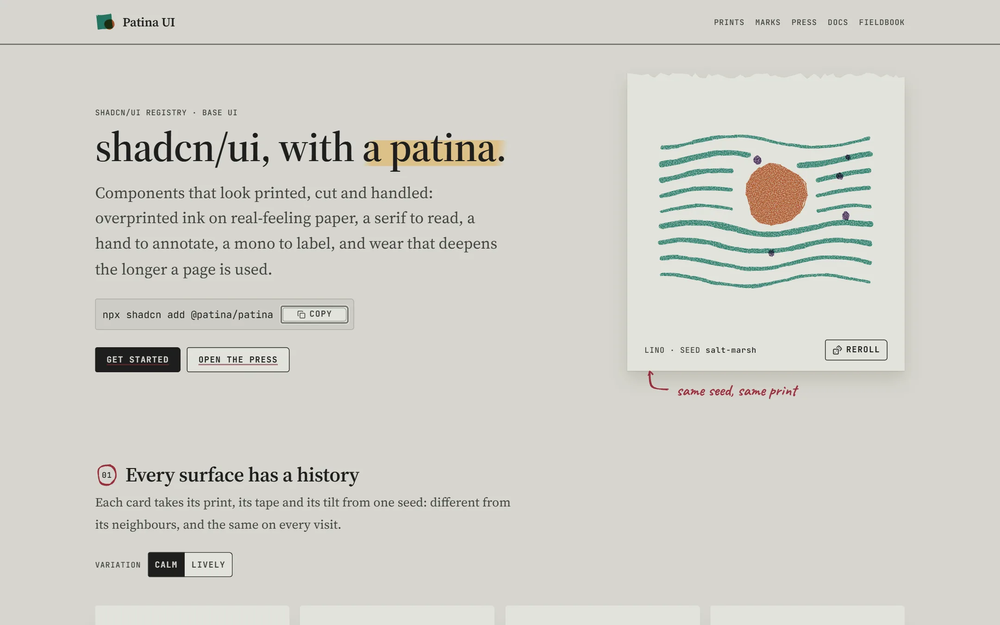
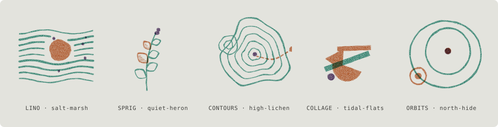
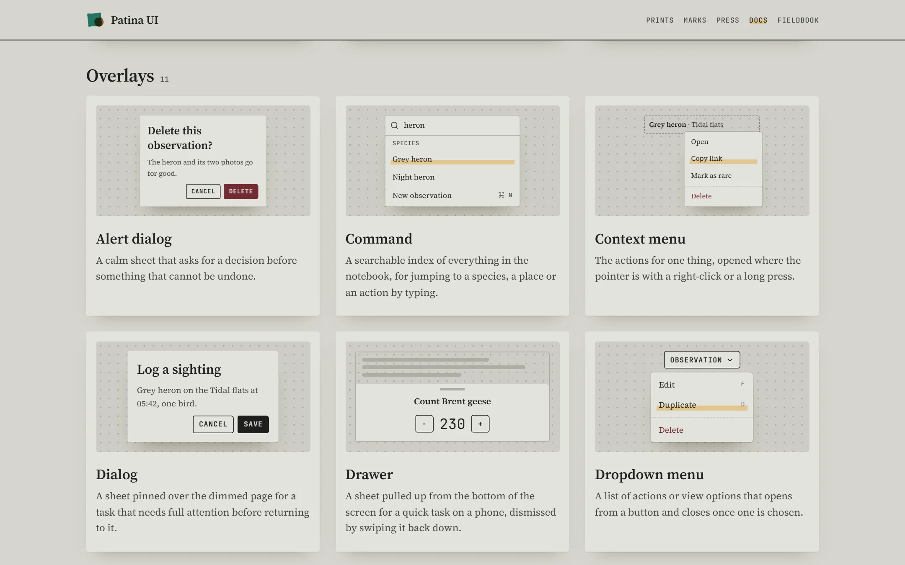
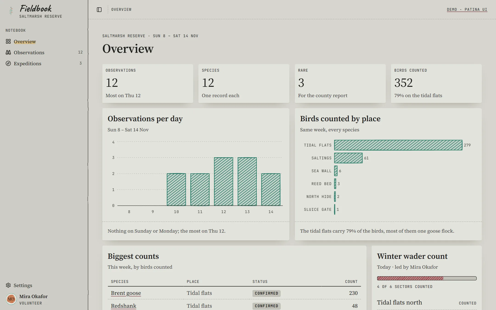
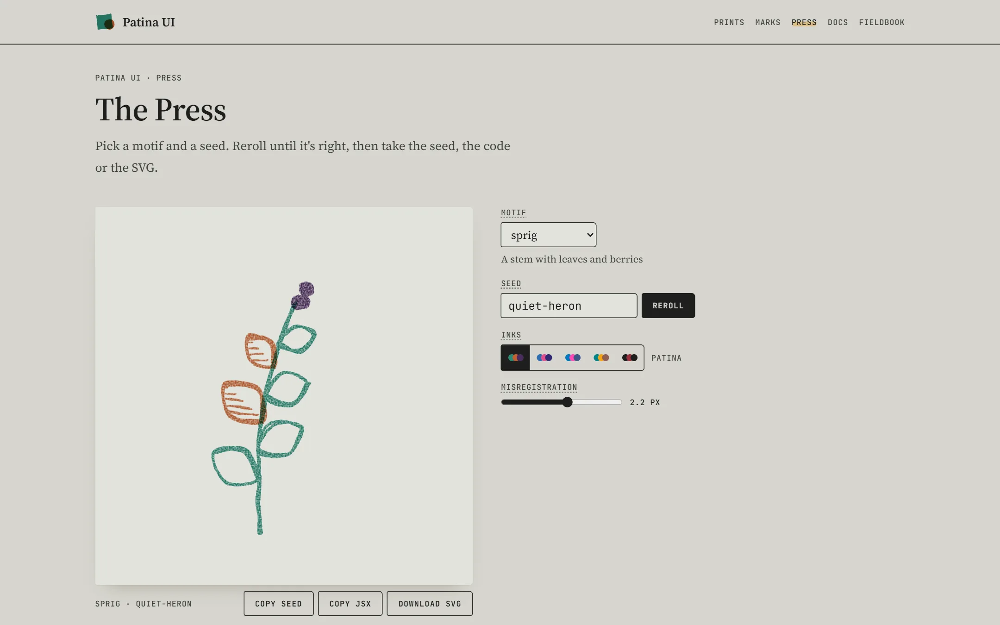
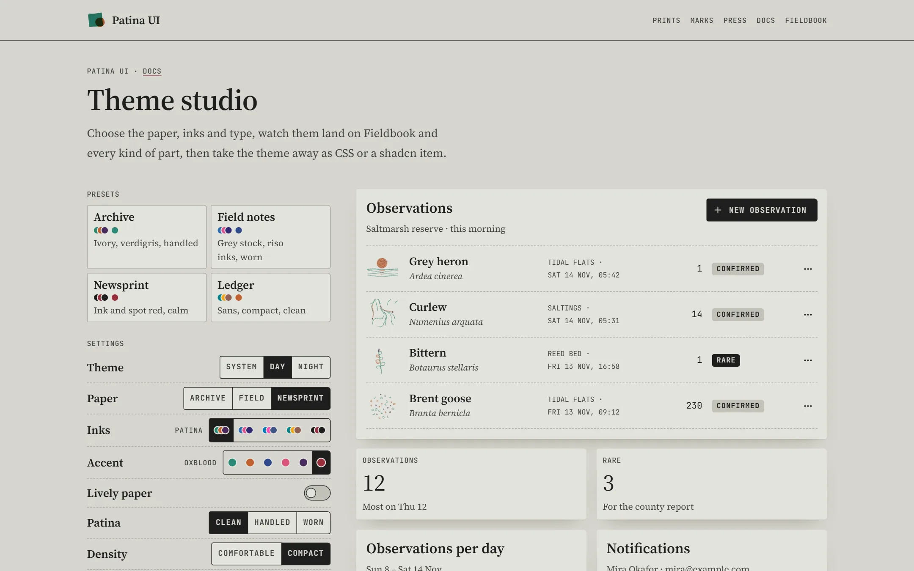

<a href="https://patinaui.com">
  <picture>
    <source media="(prefers-color-scheme: dark)" srcset=".github/readme/home-night.webp">
    
  </picture>
</a>

# Patina UI

A [shadcn/ui](https://ui.shadcn.com) component library that looks like printed matter that has been handled: warm paper, riso inks slightly out of register, a serif to read, a hand to annotate, a mono to label, and marks drawn with a pen. Every card, outline, avatar and illustration is drawn from a seed, so each one differs from its neighbours and looks the same on every render.

**[patinaui.com](https://patinaui.com)** · [Components](https://patinaui.com/docs) · [The Press](https://patinaui.com/press) · [Theme studio](https://patinaui.com/studio) · [Fieldbook](https://patinaui.com/fieldbook)

## Install

Patina installs with the shadcn CLI from its registry. Add the registry to your project's `components.json`:

```json
{ "registries": { "@patina": "https://patinaui.com/r/{name}.json" } }
```

Then add everything, or only the parts you need:

```sh
npx shadcn add @patina/patina
npx shadcn add @patina/button @patina/print @patina/notes
```

Items install into `src/patina/`, so the project needs an `@/` alias for `src/`. Three steps finish the setup:

1. Make `src/patina/styles/patina.css` your Tailwind entry.
2. Render `<PatinaDefs />` once inside `<body>`, for the shared paper and ink filters.
3. Put `appearanceScript()` in an inline `<script>` in `<head>`, so saved paper and theme apply before the first paint.

## Same seed, same print



Fifteen print motifs, each drawn in three riso drums that overprint and drift a little out of register. A seed decides every choice, so the same seed draws the same print on the server, in the browser and in every build; change one letter for a new one. Two settings tune the whole page: the variation level (calm, or lively with tilted cards and tape) and the patina (clean, handled or worn paper). Try seeds in [the Press](https://patinaui.com/press).

## What's in it

<table>
  <tr>
    <td width="50%" valign="top">
      <a href="https://patinaui.com/docs"></a>
      <p><b><a href="https://patinaui.com/docs">Components</a></b><br>Every shadcn part, with shadcn's names, props and data-slots, built on Base UI and printed in Patina, plus Patina's own extras: index cards, tickets, postmarks, sidenotes, checklists, scales.</p>
    </td>
    <td width="50%" valign="top">
      <a href="https://patinaui.com/fieldbook/overview"></a>
      <p><b><a href="https://patinaui.com/fieldbook">Fieldbook</a></b><br>A field notebook for a saltmarsh reserve, built from the kit end to end: observations, expeditions, an overview with hand-drawn charts, settings and sign-in.</p>
    </td>
  </tr>
  <tr>
    <td width="50%" valign="top">
      <a href="https://patinaui.com/press"></a>
      <p><b><a href="https://patinaui.com/press">The Press</a></b><br>Pick a motif and a seed, reroll until it's right, then take the seed, the JSX or the SVG.</p>
    </td>
    <td width="50%" valign="top">
      <a href="https://patinaui.com/studio"></a>
      <p><b><a href="https://patinaui.com/studio">Theme studio</a></b><br>Choose the paper, inks, accent, density and type, watch them land on real screens, and export the theme as CSS or a shadcn item.</p>
    </td>
  </tr>
</table>

The registry holds 98 items: the base (tokens, paper, inks and the appearance runtime), every shadcn primitive, the marks (highlighter, hand underline, margin notes, stamps, tape), prints, fourteen extras and seven blocks (sign-in, settings, dashboard, pricing, article, empty state and hero).

## Run it

Requires Node.js 24 and npm 11.

```sh
npm ci
npm run dev
```

Open `http://127.0.0.1:4782`. `package.json` lists the checks (`typecheck`, `lint`, `build`, `check:contrast`, `registry:check`, `test:consumer`). To try unpublished kit changes in another project, point its registry at `http://127.0.0.1:4782/r/{name}.json`; `npm run registry` rebuilds the registry after a kit change.

**Status:** Phase 4 is done: shadcn parity, Patina's extras, blocks, the theme studio and the site. Phase 5, release v0.1, is next. [The plan](docs/plan.md) lists the phases, decisions and open questions; [the changelog](CHANGELOG.md) what each one shipped.

## Documents

| Document                                     | What it owns                                                  |
| -------------------------------------------- | ------------------------------------------------------------- |
| [Plan](docs/plan.md)                         | Goals, decisions, phases, risks, open questions               |
| [Design language](docs/design-language.md)   | Paper, inks, type voices, marks, focus, motion                |
| [Seeded variation](docs/seeded-variation.md) | Seeds, generative prints, variation and patina levels         |
| [Architecture](docs/architecture.md)         | Repository layout, rendering, theme runtime, tokens, registry |
| [Component inventory](docs/components.md)    | Every planned component, its treatment and phase              |
| [Primitives](docs/primitives.md)             | How shadcn's parts are printed in Patina                      |
| [Demo site](docs/demo-site.md)               | Site map, the Press, theme studio, the Fieldbook demo product |
| [Quality contract](docs/quality.md)          | Accessibility, performance, definition of done                |
| [Sources](docs/sources.md)                   | References, licenses and what each contributes                |
| [AGENTS.md](AGENTS.md)                       | Working instructions for coding agents                        |

The style comes from [Mental Models](https://mentalmodels.ossianravn.dev); the working method from [Groundwork](https://github.com/ossianravn/groundwork).

## License

Code, art and generated textures: [MIT](LICENSE). The fonts (Source Serif 4, JetBrains Mono, Caveat, Instrument Sans) are under the SIL Open Font License, shipped with their Fontsource packages.
